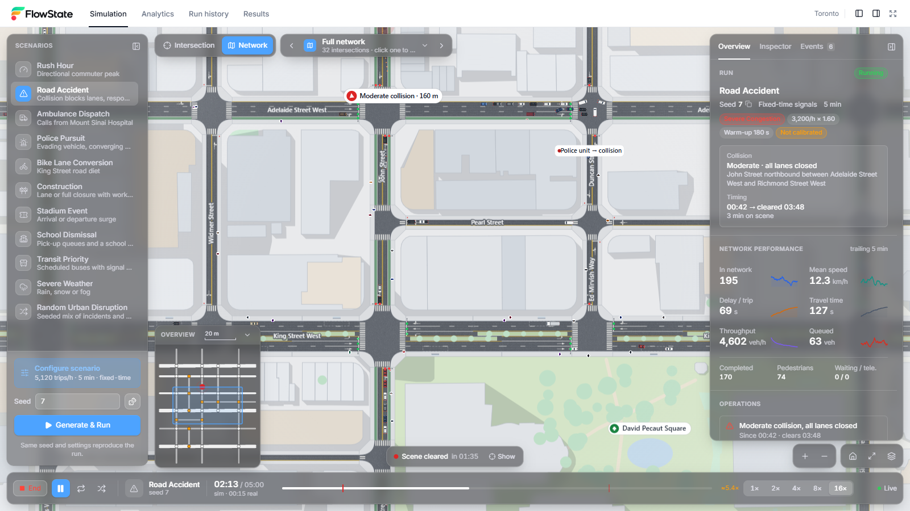
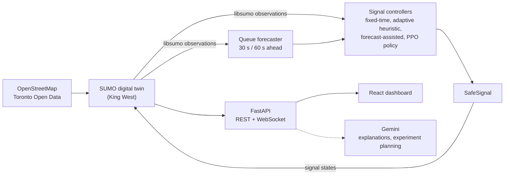
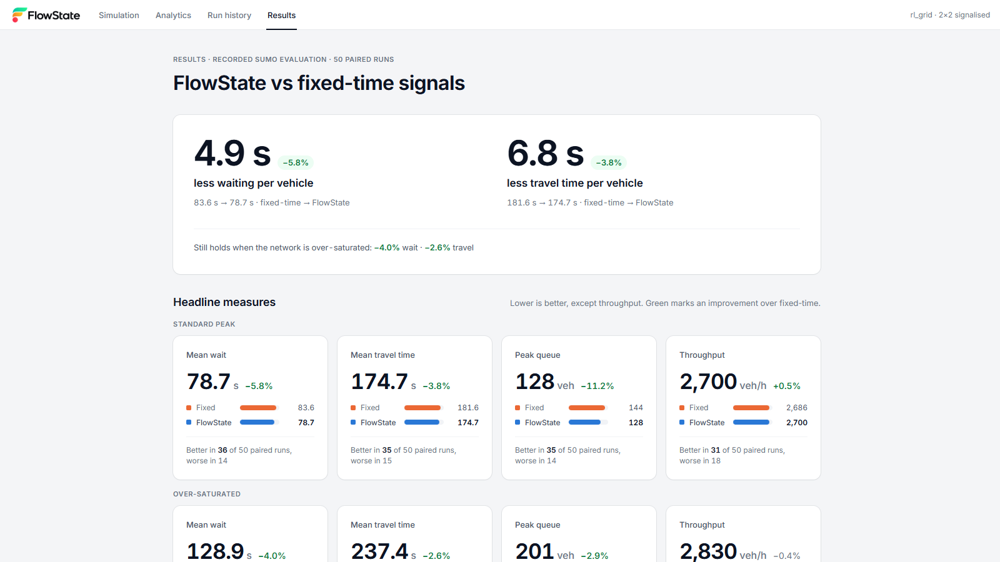
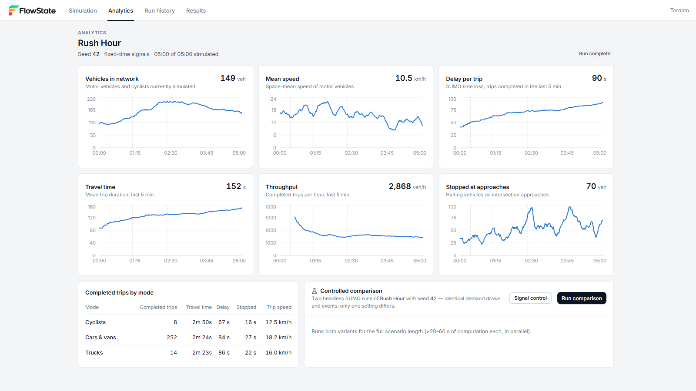

# FlowState

A digital twin of downtown Toronto for traffic-signal control: a simulator that runs real street geometry, a reinforcement learning
agent and a congestion forecaster that learn from it, and a dashboard that shows controllers competing on identical traffic.

FlowState runs [Eclipse SUMO](https://eclipse.dev/sumo/) behind a FastAPI server and draws what SUMO is doing in the browser: real
street geometry, every car, cyclist and pedestrian, signal heads, collisions, ambulances. You pick a scenario (a rush hour, a crash on
Queen Street, a stadium letting out), press run, and watch it happen. Every run comes from a seed, so the same seed reproduces the
same traffic, and two controllers can be handed the exact same vehicles and measured against each other.

## Demo video

[](https://youtu.be/HZDhzaPnSPs)

[Watch the FlowState project demo on YouTube](https://youtu.be/HZDhzaPnSPs)



*Road Accident, seed 7, at 16x. A collision closes John Street northbound, a police unit is on its way, and the queue is backing up
into the next junctions.*

## The pipeline



1. **Real-world data.** Road geometry comes from OpenStreetMap: the street lines, classes, one-way pairs and names of King West
   (Front St to Queen St, Peter St to Simcoe St). Toronto Open Data supplies the traffic-count context used to model demand.
   Together they make the Toronto digital twin. Both map extracts are committed, so a network build works offline.
2. **Traffic simulation.** SUMO simulates the vehicles, intersections, congestion, accidents and signal behaviour. The Python backend
   uses libsumo, SUMO's in-process binding, to observe every vehicle and to set signal states programmatically.
3. **Reinforcement learning.** A PPO agent is trained with Stable-Baselines3 and a Gymnasium environment wrapped around SUMO. It
   learns signal policies from interaction, with congestion and delay measurements as the reward. Fixed-time and adaptive heuristic
   controllers run alongside it as benchmarks, on exactly the same traffic. The PPO agent is trained but has not yet beaten the
   adaptive heuristic, so the heuristic stays our verified controller.
4. **Predictive machine learning.** Two gradient-boosted models, trained on 256 SUMO episodes (about 927,000 approach samples), take
   queue lengths, waiting times, signal states, downstream occupancy and recent history and predict how many vehicles will be
   halted on each approach 30 and 60 seconds ahead. On held-out seeds the 30 s model cuts prediction error by about 49 % against a
   persistence baseline (MAE 2.23 vs 4.38 vehicles).
5. **Signal optimisation.** The controllers decide from live measurements and, in the forecast-assisted version, from the congestion
   forecast. Every request goes through **SafeSignal**, which always runs the full yellow and all-red, keeps a minimum green
   (14 s, including pedestrian clearance) and forces a change at the maximum green (60 s). A controller can ask for a switch;
   it cannot make an unsafe one. We are also testing stronger predictive optimisation strategies aimed at cutting real vehicle waiting
   times further.
6. **Gemini.** Google's Gemini API powers the plain-language layer: it explains congestion patterns, interprets results and helps
   plan experiments. It never touches the signals. Its answers are checked against the measured simulation numbers, and there
   is an offline fallback when no key is available.
7. **Backend.** The FastAPI service and the SUMO engine run on a Vultr server in Toronto and expose REST endpoints and a WebSocket, so
   simulations run remotely and stream traffic to the browser in real time.
8. **Frontend.** The React dashboard is hosted on Vercel at flowstate.nyc. It shows the Toronto network, moving vehicles, signal
   states, congestion metrics and controller comparisons.
9. **Evaluation.** Fixed-time, adaptive, forecast-assisted and RL control are compared in SUMO on identical demand. We measure waiting
   time, queue length, throughput, travel time, safety outcomes (collisions and teleports) and forecasting accuracy, and feed
   what we learn back into the next controller.

### Where each stage lives

Not all of this is on `main` yet. The map, scenarios, adaptive controller and Results tab are; the RL and forecasting work sits on
its own branches.

| Stage | Code | Branch |
|---|---|---|
| Network, simulation engine, scenarios, API | `backend/flowstate/{network,sim,scenarios,api}` | `main` |
| Dashboard and Results tab | `frontend/src` | `main` |
| PPO training, SafeSignal, controllers, evaluation | `backend/flowstate/rl` | `task/rl-signal-control` |
| Queue forecaster, forecast-assisted control, Intelligence Lab | `backend/flowstate/lab` | `task/ml-intelligence` |
| Gemini explanation layer | `backend/flowstate/intelligence` | `task/ml-intelligence` |
| Congested demo scenarios for the lab | `backend/flowstate/demo` | `task/demo-scenarios-v2` |

The Toronto network is the one deployed. The PPO policy and the Intelligence Lab are trained and evaluated on a 2x2 signalised grid,
and wiring them into the deployed Toronto controller is the next integration step. The adaptive heuristic is the established
controller in the live app today.

## Controller results

Fixed-time signals against the adaptive controller on identical traffic, on the 2x2 grid: held-out seeds, five demand patterns,
50 paired runs at each demand level.

| | Fixed-time | Adaptive | Change |
|---|---:|---:|---:|
| Mean wait per vehicle, standard peak | 83.6 s | 78.7 s | -5.8 % |
| Mean travel time, standard peak | 181.6 s | 174.7 s | -3.8 % |
| Peak queue, standard peak | 144 veh | 128 veh | -11.2 % |
| Mean wait per vehicle, over-saturated | 134.3 s | 128.9 s | -4.0 % |

The Results tab in the app has every run, the per-pattern breakdown with confidence intervals, and can rerun the comparison on fresh
seeds. The PPO policy and the forecaster are evaluated the same way on their branches.



## In the app

- 11 scenarios, listed below, each with parameters you can set or leave to the seed.
- Follow a single vehicle, click a junction to see its phase and queues, click an event to jump to it.
- Pause, change speed (0.5x to 16x), restart with the same seed, or draw a new variation.
- A **controlled comparison** runs two headless SUMO runs on the same seed that differ in one setting: signal control, weather, King
  Street design and so on.



*Analytics for a finished run: speed, delay, throughput, queues and trips by mode.*

| Scenario | What the seed draws | What is measured |
|---|---|---|
| Rush Hour | peak intensity, timing, origin-destination imbalance | delay, queues, throughput |
| Road Accident | location, severity, lanes closed, time, clearance, responder delay | queue behind the scene, detours, responder arrival |
| Ambulance Dispatch | call times and scenes | response time against free flow, pre-emptions |
| Police Pursuit | origin, evasive re-targeting, unit dispatch | time to stop, closest approach |
| Bike Lane Conversion | demand (network chosen by parameter) | cyclist speed, car travel time, corridor speeds |
| Construction | location, lane or full closure | merge queue, detour |
| Stadium Event | attendance, surge timing | venue queues, network delay |
| School Dismissal | bell time, pick-up arrivals | frontage queues, pedestrian volumes |
| Transit Priority | departures with headway jitter, boardings | bus travel time, timetable delay, green extensions |
| Severe Weather | condition and severity | speed and delay against clear weather (via a comparison) |
| Random Urban Disruption | two to four non-overlapping disruptions | network delay, response |

## How the simulation works

- **SUMO owns the traffic.** Positions, headings, brake lights, signal states and the metrics all come from SUMO. The frontend only
  interpolates between real simulation steps (cubic Hermite, using SUMO's heading and speed) and never extrapolates.
- **Seeds make runs reproducible.** A scenario is built from reusable components, and the seed draws a concrete instance, for example
  "severe collision, all lanes closed on Church St southbound, 03:40 to 21:29". The same seed with the same settings gives the same
  SUMO trajectories, and there is a test for it.
- **Drivers.** IDM car following and the SL2015 lane-change model in SUMO's sublane mode, with per-run driver profiles drawn from
  the seed. Emergency vehicles use SUMO's bluelight device, so other drivers react to them.
- **Measurements.** Waiting time, travel time, throughput, queues, teleports and collisions are counted from SUMO, never estimated.

## Running it

You need Python 3.10+ and Node 18+. SUMO comes from PyPI (`eclipse-sumo`, `libsumo`), so there is nothing else to install.

```bash
./run.sh          # macOS / Linux
.\run.ps1         # Windows
```

The script creates a virtualenv, installs the backend, builds the SUMO networks if they are missing, and starts the API on port 8000
and the UI on port 5173. Open <http://127.0.0.1:5173>.

To start the pieces by hand:

```bash
python -m venv .venv && source .venv/bin/activate        # Windows: .venv\Scripts\activate
pip install -r backend/requirements.txt
cd backend && python -m flowstate.cli build-network      # once
python -m flowstate.cli serve --port 8000                # terminal 1
cd frontend && npm install && npm run dev                # terminal 2
```

The CLI also runs a scenario without the UI and prints the results as JSON:
`python -m flowstate.cli run --scenario rush_hour --seed 42`.

Keyboard: `Space` play/pause, `R` restart with the same seed, `N` new variation, `F` fit the network, `H` default view, `\` hide the
side panels, `+`/`-` zoom.

## Tests

```bash
python -m pytest tests -q                 # 177 tests: API, WebSocket, network, scenarios, real SUMO runs
cd frontend && npm test && npm run build  # 43 unit tests, then a type-checked production build
```

The Python suite includes real SUMO runs (scenario placement, closures, responders, reproducibility), so the full run takes about
nine minutes.

## Repository layout

```
backend/flowstate/
  network/    street network: OSM import (toronto.py), cross-sections and signals (city.py), render geometry
  sim/        SUMO engine loop, demand, signals, driver models, metrics, safety observations
  scenarios/  scenario framework and the 11-scenario catalog
  api/        REST + WebSocket server and the live run service
  performance/  benchmark and audit tooling (congestion presets, resource measurement)
frontend/src/
  map/        Canvas 2D renderer: road scene, vehicle sprites, camera, overlays
  views/      Analytics, Run history, Results
  components/ rails, panels, run bar     lib/  state store, WebSocket client, frame playout
data/         committed networks and OpenStreetMap extracts
tests/        pytest suite          tools/  congestion audits, OSM fetch          docs/  deployment, performance and audit notes
```

## Built with

Python, FastAPI, Eclipse SUMO 1.28 (libsumo, netconvert, sumolib), Stable-Baselines3, Gymnasium, PPO, scikit-learn (gradient-boosted
regressors), Google Gemini, React 19, TypeScript, Vite, Tailwind, Radix UI, Zustand, Recharts, Canvas 2D, pytest, Vitest, Vultr,
Vercel.

Map data is © [OpenStreetMap contributors](https://www.openstreetmap.org/copyright) (ODbL). Traffic counts come from the City of
Toronto's [open data](https://open.toronto.ca/open-data-licence/).
